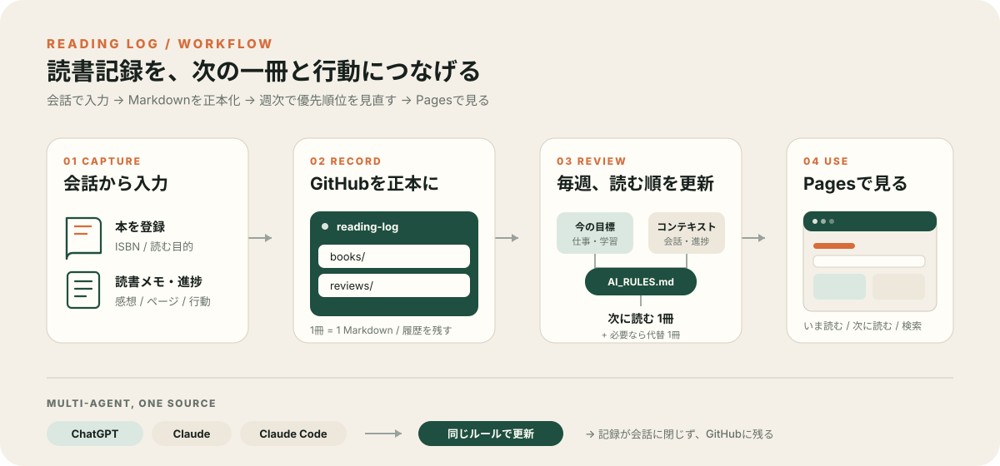

# Reading Log テンプレート

A template for a reading log that you update by talking to ChatGPT. Each book is one Markdown file in your GitHub repository, GitHub Pages shows your bookshelf, and the AI picks your next book every week based on your goals. Click "Use this template" to start. The documentation below is in Japanese.

ChatGPT に話しかけるだけで更新できる読書記録のひな形です。本は 1 冊 1 ファイルで GitHub に残り、GitHub Pages で本棚として見られ、毎週 AI が「次に読む 1 冊」を選びます。



**実例：[作者の本棚](https://n-yoshida-dev.github.io/reading-log/)**（このひな形の元になった読書記録）

## なぜ作ったか

読書記録を「残す」だけで終わらせず、**次に読む本と、読後にやることまでつなげる**ためです。記録が ChatGPT の会話の中に閉じると、あとから探せず、ほかの AI からも使えません。そこで GitHub を正本にし、どの AI も同じ決まり（`AI_RULES.md`）で読み書きするようにしました。

## どんな人に向くか

- 本を買っても積んでしまい、どれから読むか迷う人
- 読んだ感想を書くのが面倒で、記録が続かない人
- ChatGPT（有料プラン）と GitHub のアカウントを持っている人

## できること

| 機能 | 中身 |
| --- | --- |
| 話して記録 | 「今 85 ページ。ここが刺さった」と ChatGPT に話すと、その本のファイルに日付つきで追記される |
| 写真で登録 | 表紙と裏表紙のバーコードの写真から、タイトル・著者・ISBN を登録する |
| 次の 1 冊 | 毎週、あなたの目標・進み具合・残っている行動から、次に読む 1 冊を選び、100 点満点の参考点を付ける |
| 本棚の画面 | 「読書中」「次に読む」「すべての本」。検索・カテゴリの絞り込み・並べ替え |
| 記録フォーム | 画面の「記録する」で項目を埋めると、ChatGPT に貼る文章ができる（話すのが難しい場面用） |
| ほかの AI | Claude Code は `CLAUDE.md`、Codex などは `AGENTS.md` から同じ決まりを読む |

## 始め方（15 分ほど）

1. このページ右上の **Use this template → Create a new repository** で、自分のリポジトリを作る。公開範囲は **Public**（GitHub Pages を無料で使うため。記録は誰でも読めるようになる）
2. 作ったリポジトリの **Settings → Pages** で、Source を **Deploy from a branch**、Branch を **main / (root)** にして保存する。数分で `https://<ユーザー名>.github.io/<リポジトリ名>/` に空の本棚が出る
3. `_data/categories.yml` のカテゴリを、自分の読む本に合わせて書き換える（GitHub の画面の鉛筆マークで直せる）
4. ChatGPT で読書記録用の**プロジェクト**を作り、`CHATGPT_PROJECT_INSTRUCTIONS.md` の「---」から後ろを、プロジェクトの指示に貼る。`<GitHubユーザー名>/<リポジトリ名>` と「私の今の目標」を自分の物に書き換える
5. ChatGPT の設定で **GitHub を連携**し、このリポジトリへの書き込みを許可する（画面の名前は ChatGPT の更新で変わることがある）
6. プロジェクトの中で、表紙とバーコードの写真を添えて「この本を登録して。設計を学びたくて買った」と話す。本のファイルができ、数分後に本棚に出れば完了

## 毎日の使い方（作者の運用）

- 本を読んだら、スマホの ChatGPT アプリでプロジェクトを開き、**音声で**話す。「今ここまで読んで、こう思った」「ここは仕事で試したい」くらいの話し言葉で十分。ChatGPT が整えて、その本のファイルに書く
- 週に 1 回「今週の読書レビューをして」と頼む。`reviews/` にレビューができ、次に読む 1 冊が本棚の「次に読む」の先頭に来る
- 何冊もまとめて登録する・ファイルの形を変えるときは、パソコンの Claude Code で開いて頼む

## ファイルの構成

```text
books/              1 冊 1 ファイル（最初は空）
reviews/            週次レビュー。latest.md が最新
inbox/              どの本の話か分からない入力の一時置き場
templates/          本とレビューのひな形
_data/categories.yml カテゴリの一覧
AI_RULES.md         すべての AI が従う決まり（正本）
CHATGPT_PROJECT_INSTRUCTIONS.md  ChatGPT のプロジェクトに貼る指示
CLAUDE.md / AGENTS.md            Claude Code・Codex などの入口
```

## 気をつけること

- **リポジトリと本棚は誰でも読めます。** 家族・勤務先・お金・健康の話は記録に書かないでください。目標など人に見せたくない事は、ChatGPT のプロジェクトの指示（非公開）に書きます。`AI_RULES.md` の 10 で、AI にも同じことを守らせています
- 本の文章の長い引用と、市販の本の表紙の写真は保存しません（著作権のため）
- このひな形はプログラムを実行しません。動くのは GitHub Pages のサイトと、あなたが使う AI だけです

## License

MIT（`LICENSE`）。あなたが書いた読書記録は、あなたの物です。
